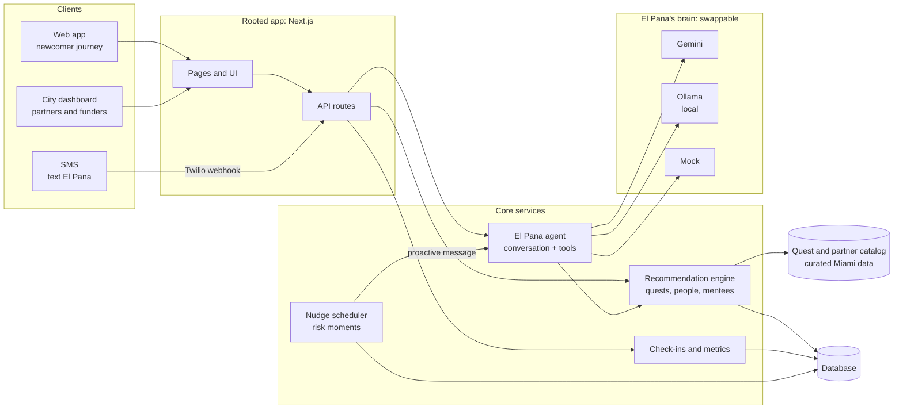
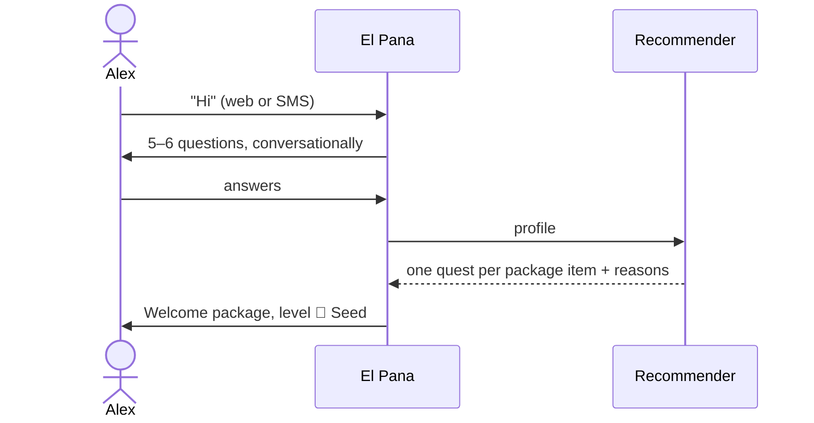
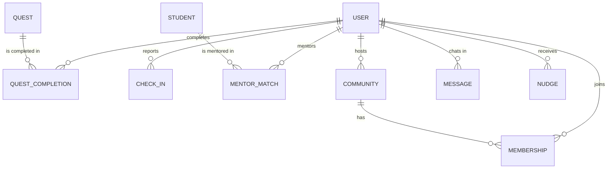

# Architecture

## System overview

## Components

| Component | Responsibility |
|---|---|
| **Web app** | Onboarding conversation, welcome package, side quests, level progress, Miamian journey |
| **SMS channel** | Text El Pana; receive proactive check-ins and nudges (Twilio) |
| **City dashboard** | Aggregate, anonymized metrics for Venture Miami, the Beacon Council, employers, funders |
| **El Pana agent** | Conversational layer. Builds a system prompt from profile + level + catalog, streams replies from the active provider, calls tools (recommend, complete quest, log check-in) |
| **Provider layer** | One interface over Gemini, Ollama and a mock. Switched by `PANA_PROVIDER` |
| **Recommendation engine** | Scores quests by interests, neighborhood, recurrence, car-free, time, level. Later: "engineers like you who stayed" from check-in outcomes |
| **Check-ins and metrics** | Monthly 5-question check-in → the four impact metrics |
| **Nudge scheduler** | Detects risk moments (quiet 3 weeks, lease renewal, coworker left, layoff) and asks El Pana to reach out first |
| **Catalog** | Curated Miami quests, communities, nonprofits, mentorship programs |

## Key flows

### 1. Onboarding → welcome package

### 2. Quest loop
Recommend → Alex completes or skips → El Pana follows up → level progress → recommender learns.

### 3. Proactive nudge (the retention moment)
Nudge scheduler detects trigger → builds context (trigger + profile + communities + mentees) → El Pana writes the message → sent by SMS → Alex's response is logged.

### 4. Check-in → metrics
El Pana asks the 5 questions monthly → stored as `CheckIn` → personal journey chart + city dashboard rollup.

## Data model

| Entity | Key fields |
|---|---|
| `User` | name, movedFrom, role, livesIn, worksIn, worksFrom, household, hasCar, interests, level, phone (optional) |
| `Quest` | title, item, level, interests, neighborhood, recurring, carFree, time, place, partner |
| `QuestCompletion` | user, quest, status (suggested / accepted / done / skipped), date |
| `Community` | name, type (sport, hobby, cause, cohort), schedule, neighborhood, host |
| `Membership` | user, community, joined, attendance streak |
| `Student` | school (FIU / MDC / UM), field, goals, language |
| `MentorMatch` | mentor, student, start, sessions, outcome (internship, job) |
| `CheckIn` | user, month, intentToStay, lifeSatisfaction, peopleOutsideWork, belonging, miamian |
| `Message` | user, role, content, channel (web / sms) |
| `Nudge` | user, trigger, message, sent, response |

## Privacy and safety
- Intent-to-leave and wellbeing data is **private to the user**; the dashboard only sees aggregates.
- "Engineers like you" signals are anonymized and aggregated; person-to-person intros are opt-in.
- Ollama mode runs fully local: conversations never leave the device.
- El Pana points to the 988 Suicide & Crisis Lifeline on serious distress and is not a therapist.
