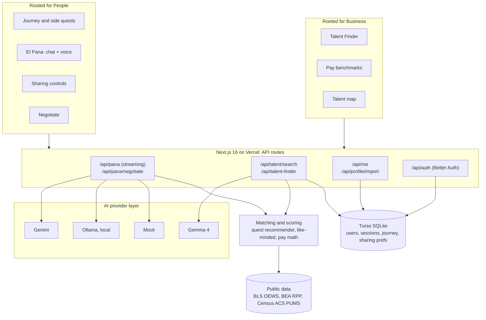

# Tech stack and architecture (deck content)

Slide-ready summary of what is built and deployed. Live at https://rooted-miami.vercel.app.

## Tech stack

| Layer | What we use | Why |
|---|---|---|
| **App** | Next.js 16 (App Router), React 19, TypeScript | UI and API in one codebase, one deploy |
| **Styling** | Tailwind CSS 4 | Fast iteration, consistent brand theme |
| **AI: El Pana (companion)** | Google Gemini (`gemini-flash-latest`) via `@google/genai`, streamed | Fast and cheap, replies appear as they're written |
| **AI: Talent Finder (companies)** | Gemma 4 (`gemma-4-26b-a4b-it`) via the Gemini API | Open model, structured matching and outreach drafts |
| **Swappable AI providers** | Gemini, Ollama (local) or mock, switched with `PANA_PROVIDER` | Private on-device option, and the demo still works offline |
| **Voice** | Browser Web Speech API | Talk to El Pana, no extra service |
| **Auth** | Better Auth (email + password, LinkedIn-ready) | One account, two profiles: People and Business |
| **Database** | Turso (hosted SQLite) + Drizzle ORM | Same schema locally and in production, free tier |
| **Resume / LinkedIn import** | `unpdf` text extraction | Builds the profile from a PDF |
| **Hosting** | Vercel (serverless, iad1) | Native Next.js support, live in minutes |
| **Data** | BLS OEWS May 2025, BEA price parities 2024, Census ACS PUMS 2023–24 | Real pay and migration numbers, with sources shown in the app |

**One-line version:** Next.js + Gemini/Gemma on Vercel, with Turso for data and Better Auth for accounts. Every number cites BLS, BEA or Census.

## Architecture

### Talking points

1. **One app, two sides.** Engineers build roots in Miami. Companies find engineers who chose to be found. Both sides share the same accounts and the same database.
2. **El Pana is grounded, not generic.** Each reply is built from the engineer's profile, level and completed quests, plus a curated Miami catalog. It can also reach out first when someone is at risk of leaving.
3. **Talent Finder is fast first, then smart.** It shows an instant deterministic match, then Gemma 4 refines the ranking and drafts a respectful first message. A pay band backed by BLS data comes with it.
4. **The AI provider can be swapped.** One setting moves the app between Gemini, a local Ollama model and a mock.

## Privacy and responsible AI by design

- **Private by default:** companies see nothing until an engineer turns on "Companies can message me".
- **Shared fields only:** companies see stack, seniority, skills, neighborhood and work mode. Check-ins, wellbeing and intent to stay are never shown to them.
- **Hide from my employer:** an engineer can make themselves invisible to specific companies.
- **Pause anytime:** an engineer can disappear from search instantly.
- **No protected traits:** the Gemma prompt forbids mentioning age, gender, ethnicity or nationality, and forbids inventing salary numbers (the pay band comes from BLS).
- **Option to keep data on the device:** with Ollama, El Pana runs locally.

## For the Q&A

- **What's simulated:** 120 synthetic engineers in Talent Finder, labeled as simulated in the app. The demo accounts are real accounts on the live site with dummy profiles.
- **What's next:** SMS through Twilio, scheduled nudges (the trigger moments already exist), and an aggregate dashboard for city partners.
